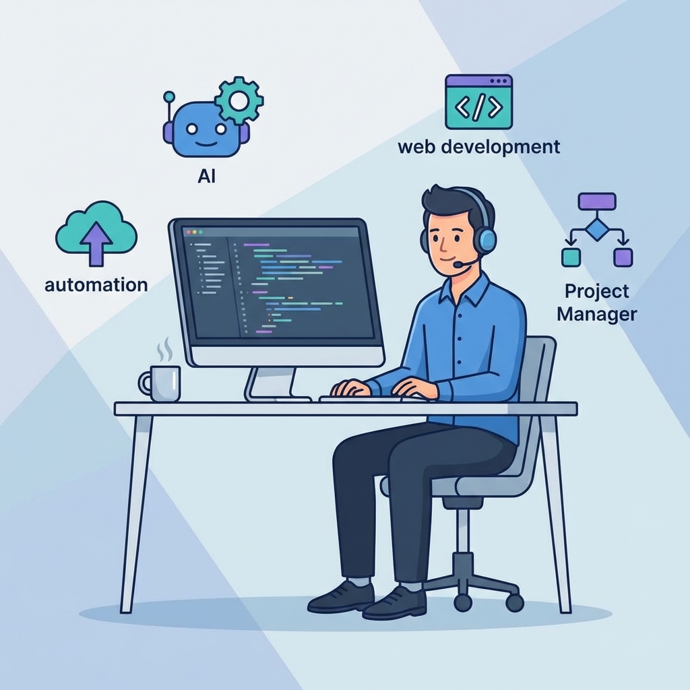
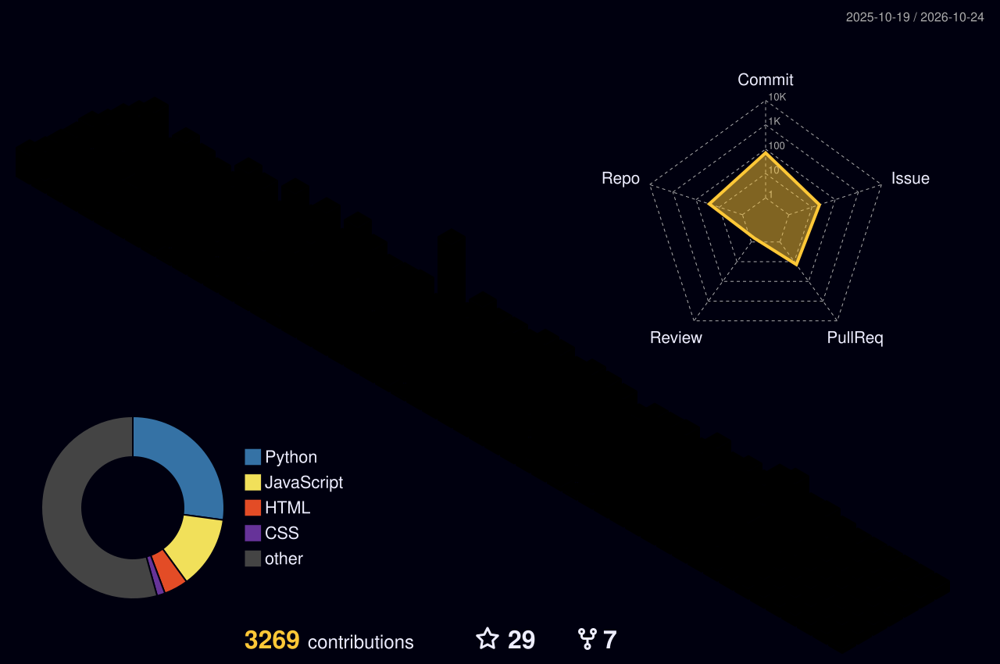

<!-- ============================================================ -->
<!--                          HEADER                              -->
<!-- ============================================================ -->

<!-- Banner -->

<!-- Typing animation -->

  

<!-- Social links -->

  

<!-- Profile views & Followers -->

---

<!-- ============================================================ -->
<!--                          ABOUT ME                            -->
<!-- ============================================================ -->

## 👨‍💻 About Me

I'm **Umesh Temburwar**, a Computer Science & Engineering graduate from **M.B.E. Society's College of Engineering, Ambajogai**, affiliated with Dr. Babasaheb Ambedkar Technological University (DBATU).

I'm passionate about building responsive web applications and solving real-world problems through technology. My interests include full-stack development, software engineering, databases, and cloud computing.

| | |
|---|---|
| 🎓 **Education** | B.Tech in Computer Science & Engineering (2022–2026) |
| 💻 **Development** | Full-stack web development |
| 🛠️ **Technologies** | React.js, JavaScript, TypeScript, Node.js, SQL |
| 🚀 **Projects** | Developer Portfolio, Coredev Academy, Inventory Management System, ByteFest 2K25 |
| ☁️ **Exploring** | Data Structures & Algorithms, AI/ML, Cloud Computing |
| 🎯 **Goal** | Grow into a skilled software engineer and build impactful technology |
| 📫 **Reach me** | [umeshtemburwar2002@gmail.com](mailto:umeshtemburwar2002@gmail.com) |

 

---

<!-- ============================================================ -->
<!--                         TECH STACK                           -->
<!-- ============================================================ -->

## 🛠️ Tech Stack

**Languages**

**Frontend**

**Backend & Databases**

**Tools**

---

<!-- ============================================================ -->
<!--                     FEATURED PROJECTS                        -->
<!-- ============================================================ -->

## 🚀 Featured Projects

| Project | Description | Tech |
|---|---|---|
| 🌐 [**Developer Portfolio**](https://umeshtemburwar.vercel.app/) | Personal portfolio showcasing my projects, skills, and journey in software engineering. | React |
| 🎓 **EdTech Learning Platform** | Learning platform with courses, quizzes, assignments, certificates, and role-based React dashboards backed by Node/Express APIs. | React · Node.js · Express · Supabase |
| 📦 **Inventory Management System** | Full-stack application for tracking stock, managing items, and streamlining inventory workflows. | React · Node.js · MongoDB |
| 🏆 **ByteFest 2K25 Website** | Official website for the ByteFest 2K25 technical fest, where I served as website developer and core organizer. | Web |

> 🔗 *Add repository links to the projects above as you publish them.*

---

<!-- ============================================================ -->
<!--                       CERTIFICATIONS                         -->
<!-- ============================================================ -->

## 📜 Certifications

| Certification | Issuer | Completed |
|---|---|---|
| Data Engineering on AWS – Foundations | AWS Training & Certification | Dec 3, 2025 |
| Fundamentals of Machine Learning and Artificial Intelligence | AWS Training & Certification | Nov 17, 2025 |

---

<!-- ============================================================ -->
<!--                        GITHUB STATS                          -->
<!-- ============================================================ -->

## 📊 GitHub Stats

  

---

<!-- ============================================================ -->
<!--                   3D CONTRIBUTION SKYLINE                    -->
<!-- ============================================================ -->

## 🏙️ 3D Contribution Skyline

  <picture>
    <source media="(prefers-color-scheme: dark)" srcset="./profile-3d-contrib/profile-night-rainbow.svg">
    <source media="(prefers-color-scheme: light)" srcset="./profile-3d-contrib/profile-green-animate.svg">
    
  </picture>

---

<!-- ============================================================ -->
<!--                 CONTRIBUTION SNAKE GRAPH                     -->
<!-- ============================================================ -->

## 🐍 Contribution Graph & Snake

  <picture>
    <source media="(prefers-color-scheme: dark)" srcset="https://raw.githubusercontent.com/Umesh-Temburwar/Umesh-Temburwar/output/github-contribution-grid-snake-dark.svg">
    <source media="(prefers-color-scheme: light)" srcset="https://raw.githubusercontent.com/Umesh-Temburwar/Umesh-Temburwar/output/github-contribution-grid-snake.svg">
    
  </picture>

---

<!-- ============================================================ -->
<!--                     CURRENTLY LEARNING                       -->
<!-- ============================================================ -->

## 🌱 Currently Learning

- 🧮 Data Structures & Algorithms
- 🗄️ Advanced SQL & database design
- ☁️ Cloud computing & data engineering
- 🤖 AI/ML fundamentals

---

<!-- ============================================================ -->
<!--                       LET'S CONNECT                          -->
<!-- ============================================================ -->

## 🤝 Let's Connect

I'm open to software development opportunities, collaborations, and conversations about web development and technology.

  

<!-- Footer banner -->

